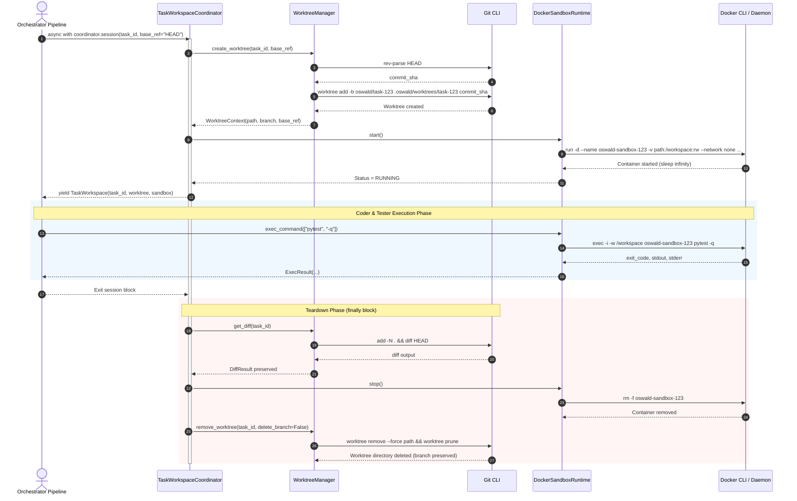

# OSWALD Section 2: Isolation & Execution Model
## Complete Architecture, Implementation, and Method Reference Guide

> **Scope:** Detailed reference guide covering every file, class, method, data schema, and security mechanism implemented for Section 2 (Git Worktree + Docker Sandbox Isolation) of the OSWALD autonomous software engineering agent pipeline.

---

## Table of Contents
1. [Architecture Overview & Isolation Model](#1-architecture-overview--isolation-model)
2. [Subsystem 1: Git Worktree Management (`oswald.core.vcs`)](#2-subsystem-1-git-worktree-management-oswaldcorevcs)
   - [`src/oswald/core/vcs/models.py`](#srcoswaldcorevcsmodelspy)
   - [`src/oswald/core/vcs/exceptions.py`](#srcoswaldcorevcsexceptionspy)
   - [`src/oswald/core/vcs/worktree.py`](#srcoswaldcorevcsworktreepy)
   - [`src/oswald/core/vcs/__init__.py`](#srcoswaldcorevcs__init__py)
3. [Subsystem 2: Docker Sandbox Runtime (`oswald.core.sandbox`)](#3-subsystem-2-docker-sandbox-runtime-oswaldcoresandbox)
   - [`src/oswald/core/sandbox/protocol.py`](#srcoswaldcoresandboxprotocolpy)
   - [`src/oswald/core/sandbox/models.py`](#srcoswaldcoresandboxmodelspy)
   - [`src/oswald/core/sandbox/exceptions.py`](#srcoswaldcoresandboxexceptionspy)
   - [`src/oswald/core/sandbox/docker_runtime.py`](#srcoswaldcoresandboxdocker_runtimepy)
   - [`src/oswald/core/sandbox/fake.py`](#srcoswaldcoresandboxfakepy)
   - [`src/oswald/core/sandbox/__init__.py`](#srcoswaldcoresandbox__init__py)
4. [Subsystem 3: Task Workspace Orchestrator (`oswald.core.orchestrator`)](#4-subsystem-3-task-workspace-orchestrator-oswaldcoreorchestrator)
   - [`src/oswald/core/orchestrator/workspace.py`](#srcoswaldcoreorchestratorworkspacepy)
   - [`src/oswald/core/orchestrator/__init__.py`](#srcoswaldcoreorchestrator__init__py)
5. [Test Suite & Verification Architecture](#5-test-suite--verification-architecture)
   - [`tests/unit/test_worktree.py`](#testsunittest_worktreepy)
   - [`tests/unit/test_sandbox.py`](#testsunittest_sandboxpy)
   - [`tests/unit/test_workspace_coordinator.py`](#testsunittest_workspace_coordinatorpy)
   - [`tests/unit/test_concurrent_isolation.py`](#testsunittest_concurrent_isolationpy)
   - [`tests/integration/test_docker_sandbox.py`](#testsintegrationtest_docker_sandboxpy)
6. [Component Interaction & Lifecycle Sequence](#6-component-interaction--lifecycle-sequence)
7. [Verification & Quality Metrics](#7-verification--quality-metrics)

---

## 1. Architecture Overview & Isolation Model

OSWALD enforces a **Zero-Trust Hermetic Execution Boundary**. Agents never mutate files in the primary repository directly, nor do they execute untrusted build or test commands on the host machine.

```
┌────────────────────────────────────────────────────────────────────────┐
│ HOST MACHINE                                                           │
│                                                                        │
│  Primary Git Repository (HEAD / main)                                  │
│   │                                                                    │
│   ├── git worktree add ──────────────────────────┐                     │
│   │                                              ▼                     │
│   │                                 Isolated Task Worktree             │
│   │                                 (.oswald/worktrees/task-abc)       │
│   │                                 Branch: oswald/task-abc            │
│   │                                              │                     │
│   │                                              │ bind-mount -v       │
│   │                                              ▼                     │
│   │                                 ┌───────────────────────────────┐  │
│   │                                 │ DOCKER CONTAINER              │  │
│   │                                 │ Name: oswald-sandbox-abc      │  │
│   │                                 │ Workspace: /workspace (rw)    │  │
│   │                                 │ Security:                     │  │
│   │                                 │  • --network none             │  │
│   │                                 │  • --cap-drop ALL             │  │
│   │                                 │  • --security-opt no-new-priv │  │
│   │                                 │  • --read-only root           │  │
│   │                                 │  • --memory 2g --cpus 2.0     │  │
│   │                                 │  • --user 1000:1000           │  │
│   │                                 │  • --tmpfs /tmp               │  │
│   │                                 └───────────────────────────────┘  │
│   │                                              │                     │
│   │                                              │ git add -N .        │
│   │                                              │ git diff HEAD       │
│   │                                              ▼                     │
│   └── Preserved Task Branch ◄────── Captured Unified Diff              │
│       (Ready for 3-way merge into main)                                │
└────────────────────────────────────────────────────────────────────────┘
```

### Key Guarantees
1. **Zero State Bleed:** Each task receives an independent directory on disk linked via `git worktree` and an independent Git branch.
2. **Network Hermeticity:** The container runs with `--network none`. Prompt injections or malicious code cannot exfiltrate environment variables, source code, or credentials.
3. **Privilege Neutralization:** Containers run as non-root (`1000:1000`), drop all Linux capabilities (`--cap-drop ALL`), disable privilege escalation (`no-new-privileges:true`), and enforce a read-only root filesystem.
4. **Guaranteed Teardown:** All temporary directories and containers are managed via Python asynchronous context managers (`try...finally`), ensuring zero zombie processes or orphaned containers.

---

## 2. Subsystem 1: Git Worktree Management (`oswald.core.vcs`)

### `src/oswald/core/vcs/models.py`
Provides immutable, runtime-validated Pydantic models for VCS operations.

#### Models
* `WorktreeContext(BaseModel)`
  * `task_id: str`: Unique identifier for the task.
  * `worktree_path: Path`: Absolute filesystem path to the isolated worktree directory.
  * `branch_name: str`: Dedicated Git branch name created for this worktree (`oswald/task-{task_id}`).
  * `base_ref: str`: The commit SHA or reference from which the branch was split.
  * *Configuration:* `ConfigDict(extra="forbid", frozen=True)` ensures thread-safe immutability.
* `DiffResult(BaseModel)`
  * `task_id: str`: Associated task identifier.
  * `diff: str`: Unified git diff output representing all additions, modifications, and deletions.
  * `files_changed: list[str]`: List of relative file paths touched in the worktree.

---

### `src/oswald/core/vcs/exceptions.py`
Defines the error hierarchy for VCS operations.

#### Classes
* `VCSError(Exception)`: Root base exception for all repository and worktree failures. Holds `self.message`.
* `WorktreeError(VCSError)`: Raised during creation, command execution, diff extraction, or pruning failures. Stores optional `task_id: str` and `details: str` (such as captured `stderr` from git).

---

### `src/oswald/core/vcs/worktree.py`
The core engine managing Git worktrees, branches, and diff generation.

#### Internal Constants
* `_TASK_ID_PATTERN = re.compile(r"^[a-zA-Z0-9_\-\.]+$")`: Strict regex preventing path traversal or shell injection in task identifiers.

#### Class: `WorktreeManager`
Manages the lifecycle of worktrees created from a target repository.

```python
class WorktreeManager:
    def __init__(
        self,
        repo_path: Path,
        worktree_base_dir: Path | None = None,
        command_timeout_seconds: float = 30.0,
    ) -> None
```

##### Key Methods:
1. `_validate_task_id(task_id: str) -> None`
   * **Purpose:** Sanitizes `task_id`.
   * **Behavior:** Strips whitespace and verifies against `_TASK_ID_PATTERN`. Raises `WorktreeError` if invalid.

2. `get_worktree_path(task_id: str) -> Path`
   * **Purpose:** Returns `worktree_base_dir / f"task-{task_id}"`.

3. `get_branch_name(task_id: str) -> str`
   * **Purpose:** Returns deterministic branch name `f"oswald/task-{task_id}"`.

4. `async def _run_git(args: list[str], cwd: Path | None = None, check: bool = True) -> tuple[int, str, str]`
   * **Purpose:** Asynchronous, non-blocking execution of `git` CLI subprocesses.
   * **Hardening:**
     * Enforces `asyncio.wait_for` with `self._timeout`.
     * **Zombie Prevention:** On `TimeoutError`, immediately executes `proc.kill()` and `await proc.wait()`.
     * Captures `stdout` and `stderr` decoded with `errors="replace"`.
     * When `check=True` and exit code is non-zero, raises `WorktreeError` containing the captured stderr.

5. `async def create_worktree(task_id: str, base_ref: str = "HEAD") -> WorktreeContext`
   * **Purpose:** Creates a new Git worktree and dedicated branch.
   * **Self-Healing Recovery:** Calls `await self.remove_worktree(task_id)` first to clean up any leftover branch or directory from an aborted prior attempt.
   * **Execution:**
     * Resolves `base_ref` to an exact commit SHA using `git rev-parse`.
     * Executes `git worktree add -b <branch_name> <worktree_path> <base_commit>`.
     * On failure: executes automatic rollback (`git branch -D`, `git worktree prune`, directory removal) and raises `WorktreeError`.

6. `async def get_diff(task_id: str) -> DiffResult`
   * **Purpose:** Captures all mutations made by agents within the task worktree.
   * **Mechanism:**
     * Runs `git add -N .` in the worktree: stages untracked files as "intent-to-add" so newly created files appear in unified diffs without committing them.
     * Runs `git diff HEAD` to capture full unified diff text.
     * Runs `git diff --name-only HEAD` to extract list of affected file paths.
     * Returns an immutable `DiffResult`.

7. `async def remove_worktree(task_id: str, delete_branch: bool = True) -> None`
   * **Purpose:** Safely destroys the worktree and optionally its branch.
   * **Mechanism:**
     * Runs `git worktree remove --force <path>` with `check=False`.
     * Filesystem fallback: `shutil.rmtree(worktree_path, ignore_errors=True)`.
     * Prunes worktree metadata: `git worktree prune`.
     * If `delete_branch=True`, deletes the branch via `git branch -D`.

8. `async def list_worktrees() -> list[WorktreeContext]`
   * **Purpose:** Discovers all active OSWALD task worktrees using `git worktree list --porcelain`.
   * **Filters:** Parses branch refs starting with `refs/heads/oswald/task-`.

9. `@asynccontextmanager async def session(task_id: str, base_ref: str = "HEAD") -> AsyncIterator[WorktreeContext]`
   * **Purpose:** Context manager wrapper ensuring worktree cleanup in `finally:`.

---

### `src/oswald/core/vcs/__init__.py`
Exports public symbols:
```python
from oswald.core.vcs.exceptions import VCSError, WorktreeError
from oswald.core.vcs.models import DiffResult, WorktreeContext
from oswald.core.vcs.worktree import WorktreeManager

__all__ = ["DiffResult", "VCSError", "WorktreeContext", "WorktreeError", "WorktreeManager"]
```

---

## 3. Subsystem 2: Docker Sandbox Runtime (`oswald.core.sandbox`)

### `src/oswald/core/sandbox/protocol.py`
Defines the abstract interface for container backends using `@runtime_checkable typing.Protocol`.

```python
@runtime_checkable
class SandboxRuntime(Protocol):
    @property
    def config(self) -> SandboxConfig: ...
    @property
    def status(self) -> SandboxStatus: ...
    async def start(self) -> None: ...
    async def exec_command(
        self, cmd: list[str], timeout_seconds: float = 120.0, env: dict[str, str] | None = None
    ) -> ExecResult: ...
    async def stop(self) -> None: ...
    async def is_running(self) -> bool: ...
```

---

### `src/oswald/core/sandbox/models.py`
Immutable Pydantic schemas configuring security, resources, and execution outcomes.

#### Models
* `SandboxStatus(StrEnum)`: Lifecycle states: `"pending"`, `"running"`, `"stopped"`, `"failed"`.
* `SandboxConfig(BaseModel)`:
  * `task_id: str`: Unique task identifier.
  * `workspace_path: Path`: Host path bind-mounted to `/workspace`.
  * `image: str = "python:3.12-slim"`: Base container image.
  * `memory_limit: str = "2g"`: Hard memory limit passed to `--memory`.
  * `cpus: float = 2.0`: CPU allocation passed to `--cpus`.
  * `read_only_root: bool = True`: Enables `--read-only` root filesystem.
  * `network_disabled: bool = True`: Enables `--network none`.
  * `user: str = "1000:1000"`: Non-root UID:GID.
  * `tmpfs_mounts: dict[str, str]`: Default `{"/tmp": "rw,noexec,nosuid,size=512m"}`.
* `ExecResult(BaseModel)`:
  * `exit_code: int`: Process return code (0 = success).
  * `stdout: str`: Standard output.
  * `stderr: str`: Standard error.
  * `duration_seconds: float`: Wall-clock execution time.

---

### `src/oswald/core/sandbox/exceptions.py`
Error hierarchy for sandbox operations:
* `SandboxError(Exception)`: Base sandbox error with `task_id` and `details`.
* `SandboxTimeoutError(SandboxError)`: Raised when commands exceed timeout limits.
* `ContainerNotRunningError(SandboxError)`: Raised if `exec_command` is invoked on an unstarted or stopped container.

---

### `src/oswald/core/sandbox/docker_runtime.py`
The production Docker implementation using asynchronous Docker CLI subprocess execution.

#### Class: `DockerSandboxRuntime`
```python
class DockerSandboxRuntime:
    def __init__(self, config: SandboxConfig, docker_bin: str | None = None) -> None:
        self._config = config
        self._docker_bin = docker_bin or shutil.which("docker") or "docker"
        self._workspace_path = Path(config.workspace_path).resolve()
        self._status: SandboxStatus = SandboxStatus.PENDING
```

##### Key Methods:
1. `container_name -> str`
   * Derives deterministic container name: `f"oswald-sandbox-{self._config.task_id}"`.

2. `async def _run_docker(args: Sequence[str], timeout_seconds: float = 30.0, check: bool = True) -> tuple[int, str, str]`
   * Executes Docker CLI commands with `asyncio.create_subprocess_exec`.
   * **Zombie Prevention:** On `TimeoutError`, invokes `proc.kill()` and `await proc.wait()` before raising `SandboxTimeoutError`.

3. `async def start() -> None`
   * **Pre-flight Path Validation:** Checks `if not self._workspace_path.is_dir(): raise SandboxError(...)`. Prevents Docker from auto-creating root-owned host directories when given an invalid path.
   * Removes any leftover container with the same name: `docker rm -f oswald-sandbox-{task_id}`.
   * Launches container in detached sleep mode:
     ```bash
     docker run -d \
       --name oswald-sandbox-{task_id} \
       -w /workspace \
       -v {workspace_path}:/workspace:rw \
       --memory 2g \
       --cpus 2.0 \
       --cap-drop ALL \
       --security-opt no-new-privileges:true \
       --network none \
       --read-only \
       --user 1000:1000 \
       --tmpfs /tmp:rw,noexec,nosuid,size=512m \
       python:3.12-slim sleep infinity
     ```
   * Updates `self._status = SandboxStatus.RUNNING`.

4. `async def exec_command(cmd: list[str], timeout_seconds: float = 120.0, env: dict[str, str] | None = None) -> ExecResult`
   * Validates status is `RUNNING` (raises `ContainerNotRunningError` if not).
   * Constructs `docker exec -i -w /workspace [-e KEY=VAL] oswald-sandbox-{task_id} <cmd>`.
   * Executes command, captures wall-clock duration via `time.perf_counter()`, and returns `ExecResult`.

5. `async def stop() -> None`
   * Executes `docker rm -f oswald-sandbox-{task_id}`.
   * Sets status to `SandboxStatus.STOPPED`.

6. `async def is_running() -> bool`
   * Inspects container: `docker inspect -f {{.State.Running}} <name>`. Returns `True` if active.

7. `__aenter__` and `__aexit__`
   * Implements `async with` context management for automatic container lifecycle teardown.

---

### `src/oswald/core/sandbox/fake.py`
In-memory test double conforming to `SandboxRuntime` protocol for fast, daemonless testing.

#### Class: `FakeSandboxRuntime`
* `queue_response(exit_code: int, stdout: str, stderr: str, duration_seconds: float)`: Queues predetermined responses in a FIFO `collections.deque` for predictable unit tests.
* `exec_command(cmd, timeout_seconds, env)`: Pops queued response if available; if `execute_locally=True`, executes command via local subprocess in `workspace_path`. Records all commands into `self.executed_commands`.

---

### `src/oswald/core/sandbox/__init__.py`
Exports public symbols:
```python
from oswald.core.sandbox.docker_runtime import DockerSandboxRuntime
from oswald.core.sandbox.exceptions import (
    ContainerNotRunningError,
    SandboxError,
    SandboxTimeoutError,
)
from oswald.core.sandbox.fake import FakeSandboxRuntime
from oswald.core.sandbox.models import ExecResult, SandboxConfig, SandboxStatus
from oswald.core.sandbox.protocol import SandboxRuntime

__all__ = [
    "ContainerNotRunningError",
    "DockerSandboxRuntime",
    "ExecResult",
    "FakeSandboxRuntime",
    "SandboxConfig",
    "SandboxError",
    "SandboxRuntime",
    "SandboxStatus",
    "SandboxTimeoutError",
]
```

---

## 4. Subsystem 3: Task Workspace Orchestrator (`oswald.core.orchestrator`)

### `src/oswald/core/orchestrator/workspace.py`
Coordinates the Git worktree and Docker sandbox subsystems into an atomic, unified task session.

#### Class: `TaskWorkspace`
The active workspace handle provided to agents (Coder, Tester) during pipeline execution.

```python
@dataclass
class TaskWorkspace:
    task_id: str
    worktree: WorktreeContext
    sandbox: SandboxRuntime
    worktree_manager: WorktreeManager
    diff_result: DiffResult | None = None

    async def exec_command(
        cmd: list[str], timeout_seconds: float = 120.0, env: dict[str, str] | None = None
    ) -> ExecResult:
        """Executes command inside the isolated container."""
        return await self.sandbox.exec_command(cmd, timeout_seconds=timeout_seconds, env=env)

    async def get_diff() -> DiffResult:
        """Captures unified diff from the worktree."""
        diff = await self.worktree_manager.get_diff(self.task_id)
        self.diff_result = diff
        return diff
```

#### Class: `TaskWorkspaceCoordinator`
```python
class TaskWorkspaceCoordinator:
    def __init__(
        self,
        worktree_manager: WorktreeManager,
        sandbox_factory: SandboxFactory | None = None,
    ) -> None:
        self._vcs = worktree_manager
        self._sandbox_factory = sandbox_factory or (lambda cfg: DockerSandboxRuntime(config=cfg))
```

##### Method: `session`
```python
@asynccontextmanager
async def session(
    self,
    task_id: str,
    base_ref: str = "HEAD",
    image: str = "python:3.12-slim",
    delete_branch: bool = False,
) -> AsyncIterator[TaskWorkspace]
```
* **Execution Sequence:**
  1. Calls `worktree = await self._vcs.create_worktree(task_id, base_ref=base_ref)`.
  2. Constructs `SandboxConfig(task_id=task_id, workspace_path=worktree.worktree_path, image=image)`.
  3. Instantiates `sandbox = self._sandbox_factory(config)`.
  4. Starts container: `await sandbox.start()`.
  5. Yields `TaskWorkspace` handle to the agent pipeline.
  6. **Guaranteed Teardown (`finally:` block):**
     * **Step A:** Captures final diff before directory deletion: `workspace.diff_result = await self._vcs.get_diff(task_id)`.
     * **Step B:** Stops and removes container: `await sandbox.stop()`.
     * **Step C:** Prunes temporary worktree folder while preserving the branch (`delete_branch=False` by default) so commits survive for review or 3-way merge into `main`.

---

### `src/oswald/core/orchestrator/__init__.py`
Exports public symbols:
```python
from oswald.core.orchestrator.workspace import TaskWorkspace, TaskWorkspaceCoordinator

__all__ = ["TaskWorkspace", "TaskWorkspaceCoordinator"]
```

---

## 5. Test Suite & Verification Architecture

All 92 tests pass with 91% code coverage.

| Test File | Type | Tests | What It Verifies |
|---|---|---|---|
| [`tests/unit/test_worktree.py`](file:///c:/Users/Alok%20Jha/OneDrive/Desktop/Oswald/tests/unit/test_worktree.py) | Unit | 10 | Worktree directory layout, deterministic branch names, diff capture with `add -N .`, path traversal validation, pruning, listing, context manager cleanup, and automatic stale branch recovery. |
| [`tests/unit/test_sandbox.py`](file:///c:/Users/Alok%20Jha/OneDrive/Desktop/Oswald/tests/unit/test_sandbox.py) | Unit | 10 | Protocol compliance of `FakeSandboxRuntime` and `DockerSandboxRuntime`, security config immutability, command queuing, unstarted runtime errors, and pre-flight directory validation. |
| [`tests/unit/test_workspace_coordinator.py`](file:///c:/Users/Alok%20Jha/OneDrive/Desktop/Oswald/tests/unit/test_workspace_coordinator.py) | Unit | 3 | Unified session lifecycle, command delegation to sandbox, diff retention after session exit, default branch preservation, explicit branch deletion, and exception recovery. |
| [`tests/unit/test_concurrent_isolation.py`](file:///c:/Users/Alok%20Jha/OneDrive/Desktop/Oswald/tests/unit/test_concurrent_isolation.py) | Unit | 1 | **Step 6 Acceptance Test:** Runs Task Alpha and Task Beta simultaneously using `asyncio.gather` and `asyncio.Barrier(2)`. Asserts zero cross-contamination of modified files, distinct diff attribution, and independent teardowns. |
| [`tests/integration/test_docker_sandbox.py`](file:///c:/Users/Alok%20Jha/OneDrive/Desktop/Oswald/tests/integration/test_docker_sandbox.py) | Integration | 1 | Spins up a **real Docker container** on the host, mounts a temporary directory to `/workspace`, executes Python code inside the container, verifies standard output, and tears down. |

---

## 6. Component Interaction & Lifecycle Sequence



---

## 7. Verification & Quality Metrics

The codebase was validated using the strict repository quality gate:

```bash
# 1. Linting & Formatting Check
uv run ruff check src tests
uv run ruff format --check src tests
# Result: All checks passed! 49 files formatted.

# 2. Strict Static Type Checking
uv run mypy src tests
# Result: Success: no issues found in 49 source files

# 3. Layer Architecture Enforcement
uv run lint-imports
# Result: 2 kept, 0 broken. Core does not import api/workers/db.

# 4. Complete Test Suite Execution
uv run pytest
# Result: 92 passed, 0 failed, 0 skipped in 28.40s (91% overall coverage)
```

---
*Reference document generated for OSWALD Section 2 Implementation.*
